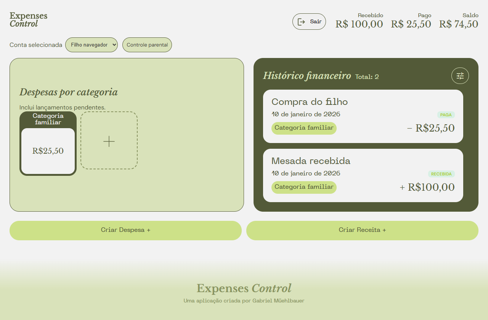

# Expenses Control Security

Sistema web de controle de finanças pessoais, reunindo o frontend e a API dos projetos originais de Gabriel Muehlbauer em um repositório único. A interface mantém React e CSS Modules; a API mantém Express, Sequelize e MySQL.

O histórico deste repositório começa com uma cópia atual, sem importar os commits anteriores. Consulte [a origem do código](docs/origem.md) e [as contribuições](docs/contribuicoes.md).

## Funcionalidades

- Cadastro e login, sessão protegida e logout no servidor.
- Cadastro, edição, exclusão e histórico de receitas e despesas, com categorias e filtros.
- Totais recebidos, pagos e saldo. Somente lançamentos pagos/recebidos entram no saldo; os pendentes continuam no histórico.
- Um comprovante PDF, JPG ou PNG de até 5 MB por lançamento, com armazenamento privado e download autorizado.
- Controle parental: o responsável cria contas de filhos, consulta seus lançamentos e define permissões. O filho inicia apenas com acesso de visualização aos próprios dados.

No dashboard, use **Conta selecionada** para alternar entre a própria conta e a de um filho direto. Em **Controle parental**, crie uma conta com e-mail e senha inicial e habilite somente as funções desejadas. Para anexar um comprovante, salve o lançamento, abra os detalhes e use **Anexar comprovante**.

## Tecnologias

- Node.js 24 LTS e npm 11.
- React 19, Vite 8, React Router e Axios.
- Express 5, Sequelize 6 e MySQL 8.4; MariaDB 10.4 foi usado nos testes locais de compatibilidade.
- Bcrypt, JWT em cookie HttpOnly, Helmet e limitação de tentativas.
- Testes com Node Test Runner, Supertest e Playwright.

As versões exatas estão no `package-lock.json`. Instale com `npm ci` na raiz, sem instalar dependências separadamente em cada aplicação.

## Execução local

Pré-requisitos: Git, Node.js 24, npm e um MySQL disponível. Docker é uma alternativa para iniciar apenas o banco.

```sh
git clone https://github.com/GabrielMuehlbauer/expenses-control-security.git
cd expenses-control-security
npm ci --ignore-scripts
```

Copie `apps/api/.env.example` para `apps/api/.env`. No PowerShell:

```powershell
Copy-Item apps/api/.env.example apps/api/.env
node -e "console.log(require('node:crypto').randomBytes(48).toString('base64url'))"
```

Coloque o valor gerado em `JWT_SECRET`. Configure o banco e suas credenciais no mesmo arquivo. Não publique esse arquivo.

Os comprovantes ficam em `apps/api/data/receipts`, fora da pasta pública e ignorados pelo Git. O usuário do processo precisa escrever nessa pasta. Para outro local privado, configure `RECEIPT_DIRECTORY` com o caminho desejado. Faça backup dessa pasta junto com o banco. Nos testes, o diretório padrão é separado (`data/test-receipts`).

Se estiver usando MySQL já instalado, crie um banco vazio `expenses_control_security` e um usuário exclusivo com acesso a ele. Não use credenciais de uma base real para os testes.

Execute no cliente SQL como administrador local, substituindo a senha de exemplo por uma senha própria:

```sql
CREATE DATABASE expenses_control_security CHARACTER SET utf8mb4 COLLATE utf8mb4_unicode_ci;
CREATE USER 'expenses_app'@'localhost' IDENTIFIED BY 'SUBSTITUA_POR_UMA_SENHA_PROPRIA';
GRANT ALL PRIVILEGES ON expenses_control_security.* TO 'expenses_app'@'localhost';
```

Essas permissões ficam limitadas ao banco local do projeto e permitem executar as migrations. Para produção, separe as credenciais de migração das credenciais de execução, concedendo ao processo da aplicação apenas as operações de dados necessárias.

Como alternativa, para usar o banco do Compose no PowerShell:

```powershell
$env:MYSQL_PASSWORD = [Net.NetworkCredential]::new('', (Read-Host 'Senha do usuário da aplicação' -AsSecureString)).Password
$env:MYSQL_ROOT_PASSWORD = [Net.NetworkCredential]::new('', (Read-Host 'Senha administrativa do banco local' -AsSecureString)).Password
docker compose up -d db
```

Use a mesma `MYSQL_PASSWORD` em `apps/api/.env`. O Compose publica o banco somente em `127.0.0.1:3306`; se a porta estiver ocupada, ajuste a porta publicada e `MYSQL_PORT`.

Depois de o banco estar pronto:

```sh
npm run db:migrate
npm run dev
```

Abra `http://localhost:5173`. A API usa a porta 3000. O Vite encaminha `/api` para a API; os cookies ficam na mesma origem do navegador. Use `localhost` consistentemente. Para outro endereço, configure `WEB_ORIGINS` com a origem exata.

Cadastre sua conta pela interface. A senha deve ter pelo menos 12 caracteres e no máximo 72 bytes. Não existe uma senha administrativa padrão.

Opcionalmente, configure `DEMO_PASSWORD` e execute `npm run db:seed`. O usuário demonstrativo é `admin@expensescontrol.com`, com a senha escolhida na configuração. Seeders são bloqueados em produção.

## Build e produção

```sh
npm run build
npm start
```

A API serve o build do frontend na mesma origem. Em produção, configure `NODE_ENV=production`, `WEB_ORIGINS` com HTTPS, segredo próprio e acesso ao banco por usuário dedicado. Use um proxy HTTPS. Não exponha o servidor de desenvolvimento do Vite. A API não habilita confiança automática em cabeçalhos de proxy.

## Testes

Copie `apps/api/.env.test.example` para `apps/api/.env.test`, configure um banco separado cujo nome termine em `_test` e gere outro `JWT_SECRET`. O usuário de teste precisa criar bancos temporários para a verificação de migração; isso é exclusivamente para o ambiente de testes.

```sh
npm run lint
npm run build
npm audit --audit-level=moderate
npm test
```

Os testes criam dados fictícios e usam conexões reais ao banco. O teste de atualização cria e remove somente um banco temporário com nome aleatório. Nunca configure uma base usada por pessoas como banco de teste.

Para os testes de navegador, execute `npm test` antes, para preparar o schema, e configure `PORT=3001` no `.env.test`. No Windows com Edge instalado:

```sh
npm run test:e2e
```

Alternativa com Chromium no PowerShell:

```powershell
npx playwright install chromium
$env:PLAYWRIGHT_CHANNEL = 'chromium'
npm run test:e2e
```

O Playwright inicia e encerra os servidores de teste nas portas 3001 e 5173. Elas precisam estar disponíveis. O banco de testes precisa continuar em execução.

## Segurança e documentação

Os controles incluem validação de entrada no servidor, rejeição de campos inesperados, isolamento por usuário, ORM, hash de senhas, sessão revogável, CSRF, CORS restrito, cabeçalhos de segurança e erros sem detalhes internos. A documentação relaciona cada controle aos testes correspondentes.

- [Arquitetura e migração](docs/arquitetura.md)
- [Controles de segurança](docs/seguranca.md)
- [Testes e resultados](docs/testes.md)
- [Origem e licença](docs/origem.md)
- [Contribuições](docs/contribuicoes.md)
- [Coleção Postman](docs/postman/Expenses-Control-Security.postman_collection.json)

Na coleção Postman, configure `email` e `password`, obtenha o CSRF e faça login. O cliente guarda os cookies automaticamente. Para consultar os dados de um filho, preencha `accountId` com seu ID; deixe vazio para a própria conta. As requisições são exemplos individuais: exclua dados demonstrativos somente depois de consultar saldo e anexar/baixar seus comprovantes.

## Interface

Exemplo com dados fictícios, mantendo as cores, tipografia e componentes do projeto original:



Licença MIT. As regras de acesso e as restrições dos comprovantes estão em [docs/seguranca.md](docs/seguranca.md).
